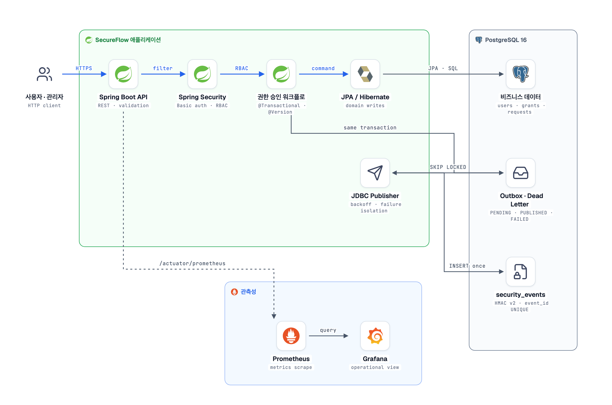

# SecureFlow

SecureFlow는 조직의 중요 권한 변경과 보안 이벤트를 수집하고, 위험한 행위를 판정하며, 조사 가능한 감사 근거를 제공하는 **접근 권한 감사·탐지 백엔드**다.

일반 비즈니스 상태와 트랜잭션은 JPA로 관리하고, 대량 보안 이벤트 적재·검색·시간 구간 집계는 JDBC로 분리한다. 현재 구현된 사용자·권한·멱등성 기반 위에 권한 승인, Transactional Outbox, 보안 이벤트 탐지와 경보 워크플로를 단계적으로 완성한다.

- [포트폴리오 목표 제품·백엔드 아키텍처](docs/project/portfolio-product-architecture.md)
- [단계별 구현 로드맵](docs/project/implementation-roadmap.md)
- [대화형 목표 아키텍처 다이어그램](.archify/architecture-secureflow-security-platform-20261102-150735/secureflow-security-platform.html)
- [코드 근거 기반 현재 아키텍처](.archify/architecture-secureflow-current-20261102-163000/secureflow-current.html)

## 현재 아키텍처

[](docs/assets/architecture/secureflow-architecture.html)

권한 요청은 Spring Security의 RBAC 검사를 거쳐 JPA 트랜잭션에서 처리된다. 같은 트랜잭션에 감사 Outbox를 남긴 뒤, 별도 JDBC Publisher가 `FOR UPDATE SKIP LOCKED`로 이벤트를 선점해 `security_events`에 멱등 적재한다. 실패 이벤트는 지수 backoff로 재시도하고 한도 초과 시 Dead Letter로 격리한다. 이미지에는 흰색 배경을 고정했고, 클릭하면 `stack-diagram`으로 만든 자체 포함 상세 HTML이 열린다.

## IntelliJ 시작 방법

1. IntelliJ IDEA에서 이 `secureflow` 폴더를 **Open** 한다.
2. Gradle JVM을 **JDK 21**로 설정한다. (`Settings → Build Tools → Gradle`)
3. 터미널에서 PostgreSQL을 실행한다.

   ```bash
   docker compose up -d --wait
   ```

   SecureFlow은 호스트 포트 `5433`을 사용한다. 이미 다른 PostgreSQL이 `5432`를 쓰는 개발 환경과 충돌하지 않게 분리한 설정이다.

4. IntelliJ에서 `SecureflowApplication`을 실행하거나 터미널에서 실행한다.

   ```bash
   SECUREFLOW_BOOTSTRAP_ADMIN_EMAIL=admin@example.com \
   SECUREFLOW_BOOTSTRAP_ADMIN_PASSWORD='change-this-password' \
   AUDIT_HMAC_SECRET='replace-with-at-least-32-characters' \
   ./gradlew bootRun
   ```

   Transactional Outbox Publisher까지 실행하려면 다음 환경 변수를 추가한다.

   ```bash
   OUTBOX_PUBLISHER_ENABLED=true \
   AUDIT_HMAC_KEY_ID=local-v1 \
   AUDIT_HMAC_SECRET='replace-with-at-least-32-characters' \
   SECUREFLOW_BOOTSTRAP_ADMIN_EMAIL=admin@example.com \
   SECUREFLOW_BOOTSTRAP_ADMIN_PASSWORD='change-this-password' \
   ./gradlew bootRun
   ```

5. 테스트를 실행한다.

   ```bash
   ./gradlew test
   ```

## 멱등성 키 관측

애플리케이션 실행 후 Prometheus와 Grafana를 시작한다.

```bash
docker compose up -d prometheus grafana
```

- Prometheus: `http://localhost:9090`
- Grafana: `http://localhost:3001` (`admin` / `secureflow`)
- 애플리케이션 메트릭: `http://localhost:8081/actuator/prometheus`

세부 실습은 [Grafana 관측 가이드](docs/study/06-idempotency-observability.md)에 정리했다.

## 첫 API 호출

```bash
curl -i -X POST http://localhost:8081/api/users \
  -H 'Content-Type: application/json' \
  -d '{"name":"Hyeonjun","email":"hyeonjun@example.com","password":"secure-password-123"}'
```

문서의 시작점은 [docs/README.md](docs/README.md)다. 학습, 딥다이브, 프로젝트 설계, PAAR 사례, 트러블슈팅을 분리해 관리한다.
